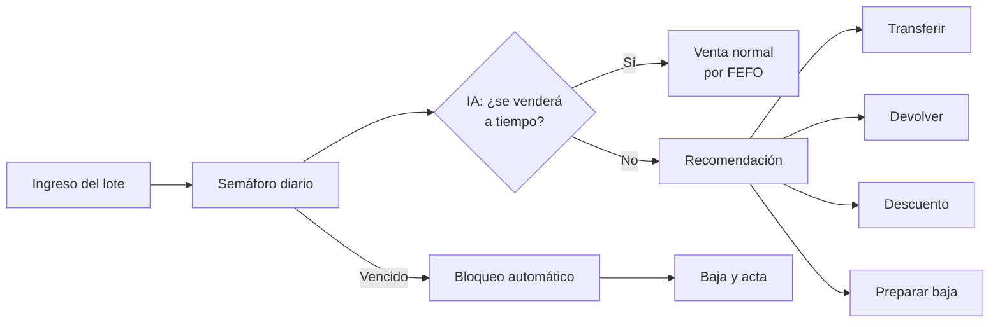
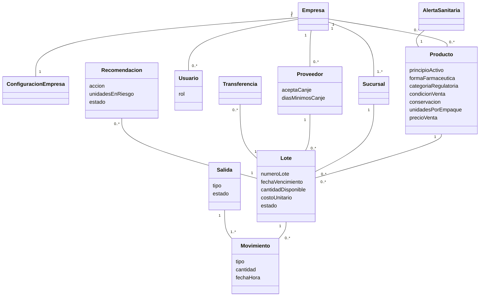
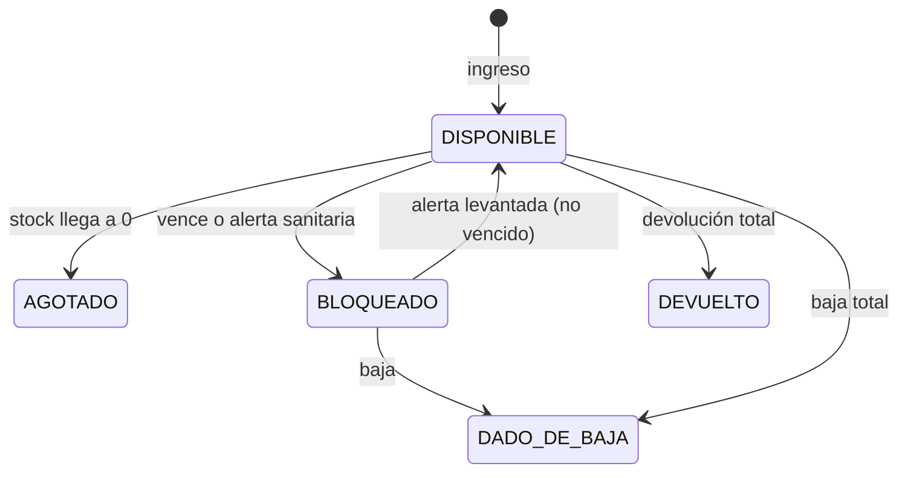

# Farmalerta — Especificación completa

Aplicación web monolítica para farmacias, boticas y cadenas que controla cada lote de producto farmacéutico según su fecha de vencimiento, avisa con anticipación, recomienda con Inteligencia Artificial qué hacer con lo que está por vencer e impide vender lo vencido.

Este documento contiene todo lo necesario para construir la aplicación: instrucciones de desarrollo, problema, marco legal, requisitos, actores, clasificación de productos, casos de uso, modelo de datos, reglas de negocio, módulo de IA, estructura del proyecto, rutas, pantallas, casos de verificación, plan de trabajo y guion de demostración.

---

## 0. Instrucciones para Claude Code

### 0.1 Documentos que recibes

Recibes solo dos documentos:

1. **`EJEMPLO_Laboratorio_...md`**: es el **molde técnico**. Define el framework, las dependencias, la organización de carpetas, el estilo de código y la forma de construir controladores, servicios, repositorios, entidades y vistas.
2. **Este documento**: define **qué** construir: el problema, los actores, las reglas, las funcionalidades y las pantallas.

Cuando algo técnico no esté definido aquí, haz lo que hace el EJEMPLO.

### 0.2 Qué tomar del EJEMPLO

- **Mismo stack:** Java 21, Spring Boot (versión estable), Maven con wrapper (`mvnw`), Spring Web, Spring Data JPA, PostgreSQL Driver, Thymeleaf, Spring Boot DevTools y Bootstrap 5 cargado desde CDN.
- **Misma arquitectura:** aplicación **monolítica** en capas: navegador → Controller → Service → Repository → Entity → PostgreSQL.
- **Misma organización de paquetes:** paquete base `pe.edu.empresa.farmalerta`, con los subpaquetes `controller`, `model`, `repository` y `service`, y la clase `FarmalertaApplication` en el paquete base.
- **Mismo estilo de código:**
  - Entidades JPA con `@Entity` y `@Table`, constructor vacío, constructor con campos, y getters y setters escritos a mano.
  - Repositorios que extienden `JpaRepository`, con consultas derivadas por nombre de método (`findBy...`).
  - Cada servicio es una **interfaz** (`LoteService`) con su **implementación** (`LoteServiceImpl`) anotada con `@Service`.
  - Las reglas de negocio y las validaciones viven en el `ServiceImpl`, en métodos privados con nombre claro (como `validarProducto` del EJEMPLO), y lanzan `IllegalArgumentException` o `IllegalStateException` con un mensaje en español.
  - Los controladores son `@Controller` de Spring MVC que devuelven vistas Thymeleaf y dependen de la **interfaz** del servicio, inyectada por constructor.
  - Vistas en `src/main/resources/templates/<modulo>/lista.html`, `formulario.html` y `detalle.html`, y estilos en `static/css/styles.css`.
  - Rutas al estilo del EJEMPLO: `GET` para ver, `POST` para crear o ejecutar acciones, `POST /{id}/accion` para acciones sobre un registro, y `redirect:` después de cada `POST`.
- **Misma configuración:** `application.properties` con PostgreSQL local y `spring.jpa.hibernate.ddl-auto=update`.

### 0.3 Lo que se agrega al EJEMPLO, y nada más

- **Una sola dependencia adicional:** `spring-security-crypto`, **solo** para cifrar contraseñas con `BCryptPasswordEncoder`. No se usa Spring Security completo.
- **Login con `HttpSession`:** el usuario se guarda en la sesión al iniciar sesión, y cada controlador obtiene el usuario actual mediante el servicio de usuarios.
- **Un fragmento Thymeleaf** reutilizable para la barra de navegación (`templates/fragmentos/navbar.html`), para no repetirla en cada página.
- **`@EnableScheduling`** en `FarmalertaApplication`, para la revisión diaria automática.
- **Una clase `DatosIniciales`** en el paquete base (`@Component` que implementa `CommandLineRunner`), que carga los datos de demostración si la base está vacía.
- **Las enumeraciones** se crean en el paquete `model`.

No crees paquetes adicionales (`dto`, `config`, `exception`, `util`, etc.), no uses Lombok, no uses MapStruct y no expongas una API REST. Todo se resuelve con las cuatro capas del EJEMPLO.

### 0.4 Forma de trabajo

- **No se usa TDD** en este proyecto. No es obligatorio escribir pruebas automatizadas. La verificación se hace con los **casos de verificación** de la sección 16, ejecutándolos en la aplicación.
- **Código simple**, al nivel del EJEMPLO: nombres en español, métodos cortos, sin patrones ni abstracciones que el EJEMPLO no use.
- **Montos con `BigDecimal`**, igual que el precio del EJEMPLO, y fechas con `LocalDate` y `LocalDateTime`.
- **La fecha de hoy nunca se obtiene con `LocalDate.now()` directamente:** siempre se pide a `FechaService` (sección 13.4), para poder simularla en la demostración.
- Trabaja **por módulos**, en el orden de la sección 17. Al terminar cada módulo, verifica sus casos de la sección 16.
- Haz commits por módulo (por ejemplo, `feat: modulo de lotes y semaforo`), sin la línea de coautoría de Claude.
- El `README.md` explica cómo crear la base de datos, cómo ejecutar con `mvnw.cmd spring-boot:run` o `./mvnw spring-boot:run`, y las cuentas de prueba.

---

## 1. Problema

Las farmacias y boticas independientes, y muchas cadenas pequeñas, controlan los vencimientos con cuadernos, hojas de cálculo o la memoria del personal. Esto produce tres problemas:

1. **Pérdida económica.** Los lotes vencen en el almacén sin que nadie lo note a tiempo para venderlos, devolverlos al proveedor o moverlos a otro local donde se vendan más rápido.
2. **Riesgo para la salud.** Se dispensan medicamentos vencidos porque nadie los retiró del estante, o productos que vencen en medio del tratamiento del paciente.
3. **Riesgo legal y sanitario.** Tener o vender productos vencidos es una infracción sanitaria, una infracción al Código de Protección al Consumidor e incluso un delito (sección 2).

## 2. Marco legal de referencia

Resume la normativa peruana que justifica las reglas del sistema. **No constituye asesoría legal.**

- **Delito.** Según la DIGEMID, comercializar medicamentos vencidos está tipificado en el artículo 294 del Código Penal, con penas de 4 a 8 años de prisión.
- **Infracción sanitaria.** La Ley 29459 prohíbe la dispensación, tenencia y transferencia de productos vencidos. El Reglamento de Establecimientos Farmacéuticos (D.S. 014-2011-SA y modificatorias) fija las sanciones; tener productos vencidos se ha sancionado con 3 UIT en resoluciones regionales.
- **Fiscalización real.** En junio de 2026, el Minsa informó el cierre de 666 farmacias y boticas en operativos nacionales, en los que se detectó, entre otras infracciones, la venta de medicamentos vencidos.
- **Interpretación de la fecha.** Si el envase indica solo mes y año, el producto vence el **último día de ese mes** (Directiva Sanitaria 031-MINSA/DIGEMID, citada por el Indecopi).
- **Deber de informar.** El Código de Protección y Defensa del Consumidor (Ley 29571) obliga a dar información relevante. El Indecopi ha exigido informar la fecha de vencimiento de los productos vendidos próximos a vencer o el mismo día de su caducidad.
- **El aviso "bajo su propio riesgo" no protege al local.** El artículo 50 del Código de Protección al Consumidor declara ineficaces las cláusulas que excluyen o limitan la responsabilidad del proveedor o la trasladan al consumidor. Por eso el sistema **impide** entregar un lote que vencerá antes de terminar el tratamiento, en lugar de depender de un descargo.
- **Publicidad de productos con receta.** La Ley 29459 solo permite promocionarlos ante profesionales de la salud. Por eso sus descuentos se aplican al dispensar, pero no se publican como ofertas.
- **Canje por vencimiento.** Los proveedores suelen aceptar el canje de productos próximos a vencer dentro de un plazo acordado.

**Conclusión para el diseño:** vender el **último día de validez es legal**, pero solo si el paciente lo usará ese día, se le informa explícitamente y lo autoriza un químico farmacéutico. Vender un producto **vencido** nunca está permitido.

## 3. Mercado y propuesta de valor

- **Clientes:** boticas independientes (una sucursal) y cadenas pequeñas y medianas (varias sucursales) sin un sistema farmacéutico.
- **Modelo:** suscripción mensual por sucursal.
- **Propuesta:** reducir las pérdidas por vencimiento, evitar sanciones y proteger al paciente.
- **Diferencial:** la IA predice si cada lote se venderá a tiempo y recomienda la mejor acción: transferir, devolver, rebajar o dar de baja.

---

## 4. Alcance

**Incluye:** catálogo de productos con clasificación farmacéutica, proveedores, ingreso de lotes, semáforo de vencimientos, revisión diaria automática, registro de salidas (venta, baja, devolución y transferencia), venta por FEFO con descuentos y advertencias, alertas sanitarias, módulo de IA (predicción de demanda y recomendaciones), reportes, acta de bajas en CSV, ofertas públicas, configuración por empresa y varias empresas con una o varias sucursales.

**No incluye:** ver la sección 19.

---

## 5. Requisitos

Prioridad: **M** = imprescindible, **S** = importante, **C** = deseable, **F** = fase futura.

### 5.1 Requisitos funcionales

- **RF-01 (M).** El administrador de la plataforma registra empresas, sus sucursales y su gerente.
- **RF-02 (M).** Los usuarios inician sesión y solo ven los datos de su empresa y su sucursal.
- **RF-03 (M).** El gerente configura los umbrales de alerta, los descuentos y las políticas de su empresa.
- **RF-04 (M).** Se registran productos con su clasificación farmacéutica.
- **RF-05 (M).** Se registran proveedores con su política de canje.
- **RF-06 (M).** El técnico registra el ingreso de lotes.
- **RF-07 (M).** El sistema muestra un semáforo con el nivel de alerta de cada lote.
- **RF-08 (M).** Una revisión diaria automática bloquea lo vencido y genera notificaciones.
- **RF-09 (M).** El químico farmacéutico registra alertas sanitarias de retiro de lotes.
- **RF-10 (M).** Se registran ventas eligiendo automáticamente los lotes por FEFO.
- **RF-11 (M).** La venta aplica el descuento del nivel de alerta y muestra las advertencias.
- **RF-12 (M).** El químico farmacéutico da de baja lotes vencidos o deteriorados.
- **RF-13 (S).** El químico farmacéutico devuelve lotes al proveedor dentro de su ventana de canje.
- **RF-14 (S).** El químico farmacéutico transfiere lotes entre sucursales de la misma empresa.
- **RF-15 (M).** La IA predice la demanda diaria de cada producto en cada sucursal.
- **RF-16 (M).** La IA calcula cuántas unidades de cada lote no se venderán antes de vencer.
- **RF-17 (M).** La IA recomienda una acción para cada lote en riesgo, y el químico farmacéutico la acepta o la rechaza.
- **RF-18 (S).** Reporte mensual de pérdidas y recuperaciones.
- **RF-19 (S).** Acta de bajas descargable en CSV.
- **RF-20 (S).** Listado público de ofertas, solo con productos sin receta.
- **RF-21 (C).** Registro de temperatura de refrigeradoras para productos de cadena de frío.
- **RF-22 (F).** Resumen semanal redactado por un modelo de lenguaje.

### 5.2 Requisitos no funcionales

- **RNF-01, arquitectura.** Monolito en capas con la organización del EJEMPLO.
- **RNF-02, seguridad.** Contraseñas cifradas con BCrypt y verificación del rol en cada acción.
- **RNF-03, aislamiento.** Ninguna pantalla muestra datos de otra empresa.
- **RNF-04, trazabilidad.** Todo movimiento de stock se registra con usuario, fecha, hora y motivo, y nunca se edita ni se borra.
- **RNF-05, exactitud.** Montos con `BigDecimal` y dos decimales; fechas con `LocalDate`.
- **RNF-06, explicabilidad.** Cada recomendación de la IA muestra los números que la justifican.
- **RNF-07, usabilidad.** Las pantallas usan Bootstrap y funcionan en el celular.
- **RNF-08, simplicidad.** Código al nivel del EJEMPLO, sin paquetes ni dependencias extra fuera de lo indicado en 0.3.

---

## 6. Actores y roles

**Usuarios del sistema**

- **Administrador de la plataforma:** registra empresas, sucursales y gerentes.
- **Gerente** (de una empresa): configura la empresa, gestiona usuarios, productos y proveedores, y ve los reportes de todas sus sucursales.
- **Químico farmacéutico** (de una sucursal): es el responsable sanitario. Confirma ventas del último día, da de baja, devuelve, transfiere, registra alertas sanitarias y decide sobre las recomendaciones de la IA.
- **Técnico en farmacia** (de una sucursal): ingresa lotes y registra ventas.

**Actores externos (sin cuenta)**

- **Proveedor o droguería:** recibe devoluciones según su política de canje.
- **Autoridad sanitaria** (DIGEMID o la autoridad regional): emite alertas de retiro de lotes y recibe el acta de bajas en una inspección.
- **Cliente o paciente:** recibe el producto y las advertencias, y puede ver las ofertas públicas.

**Permisos**

- Configurar la empresa y gestionar usuarios: gerente.
- Registrar productos y proveedores: gerente y químico farmacéutico.
- Ingresar lotes y registrar ventas: técnico y químico farmacéutico.
- Confirmar o rechazar la venta del último día: químico farmacéutico.
- Dar de baja, devolver, transferir, registrar y levantar alertas sanitarias, y decidir sobre recomendaciones: químico farmacéutico.
- Recibir una transferencia: químico farmacéutico o técnico de la sucursal de destino.
- Ver reportes: gerente (toda la empresa) y químico farmacéutico (su sucursal).
- Registrar empresas y sucursales: administrador de la plataforma.

---

## 7. Clasificación de productos

Cada producto se clasifica en cuatro dimensiones, todas como enumeraciones en el paquete `model`.

### 7.1 Categoría regulatoria (`CategoriaRegulatoria`)

- **MEDICAMENTO:** especialidades farmacéuticas y genéricos.
- **PRODUCTO_BIOLOGICO:** vacunas, insulinas y otros de origen biológico.
- **PRODUCTO_NATURAL:** medicamentos herbarios y recursos terapéuticos naturales.
- **PRODUCTO_DIETETICO:** fórmulas infantiles, suplementos y edulcorantes.
- **DISPOSITIVO_MEDICO:** jeringas y gasas estériles, tiras reactivas, pruebas rápidas, preservativos.
- **PRODUCTO_SANITARIO:** cosméticos como bloqueadores solares, y productos de higiene personal y doméstica.

### 7.2 Forma farmacéutica (`FormaFarmaceutica`)

TABLETA (incluye comprimidos y grageas), CAPSULA, POLVO_PARA_RECONSTITUIR, JARABE, SUSPENSION_ORAL, SOLUCION_ORAL (incluye gotas y sales de rehidratación), INYECTABLE (ampollas, viales, jeringas prellenadas), SOLUCION_PARA_INFUSION (sueros), SEMISOLIDO_TOPICO (cremas, ungüentos, geles), LIQUIDO_TOPICO (lociones, antisépticos), OFTALMICO, OTICO, NASAL, INHALADOR, SUPOSITORIO_OVULO, PARCHE_TRANSDERMICO y OTRA (dispositivos médicos, dietéticos y sanitarios).

### 7.3 Condición de venta (`CondicionVenta`)

SIN_RECETA, CON_RECETA y CON_RECETA_ESPECIAL (estupefacientes y psicotrópicos). En esta versión solo afecta la publicación de ofertas (RN-16): el sistema no valida recetas, porque el problema que resuelve es el vencimiento.

### 7.4 Conservación (`Conservacion`)

AMBIENTE (hasta 25 °C o 30 °C) y REFRIGERADO (de 2 °C a 8 °C, como insulinas y vacunas). REFRIGERADO habilita el módulo opcional de cadena de frío.

Además, un producto puede tener **umbrales de alerta propios** que reemplazan los de la empresa.

---

## 8. Casos de uso

- **CU-01 Registrar empresa y sucursales** (M). Administrador de la plataforma.
- **CU-02 Iniciar y cerrar sesión** (M). Cualquier usuario. RN-34, RN-35.
- **CU-03 Configurar la empresa** (M). Gerente. RN-03, RN-36.
- **CU-04 Gestionar productos y proveedores** (M). Gerente o químico farmacéutico.
- **CU-05 Ingresar un lote** (M). Técnico. RN-01, RN-04 a RN-07.
- **CU-06 Consultar el semáforo** (M). Todos los usuarios de la sucursal. RN-02, RN-03.
- **CU-07 Registrar una venta** (M). Técnico. RN-08 a RN-17.
- **CU-08 Confirmar o rechazar la venta del último día** (M). Químico farmacéutico. RN-15.
- **CU-09 Ejecutar la revisión diaria** (M). El sistema. RN-18, RN-37.
- **CU-10 Registrar y levantar una alerta sanitaria** (M). Químico farmacéutico. RN-19.
- **CU-11 Dar de baja un lote** (M). Químico farmacéutico. RN-20 a RN-22.
- **CU-12 Devolver al proveedor** (S). Químico farmacéutico. RN-23, RN-24.
- **CU-13 Transferir a otra sucursal** (S). Químico farmacéutico de origen y personal de destino. RN-25 a RN-27.
- **CU-14 Revisar recomendaciones de la IA** (M). Químico farmacéutico. RN-28 a RN-33.
- **CU-15 Consultar reportes y descargar el acta** (S). Gerente o químico farmacéutico. RN-38.
- **CU-16 Ver ofertas públicas** (S). Cliente, sin cuenta. RN-16.
- **CU-17 Registrar temperatura de refrigeradora** (C). Técnico. RN-39.

### Flujo principal



---

## 9. Modelo de datos

Todas las clases de esta sección son **entidades JPA en el paquete `model`**, escritas como el `Producto` del EJEMPLO: `@Entity`, `@Table` con nombre en plural, `@Id` con `GenerationType.IDENTITY`, `@Column` con sus restricciones, constructores y getters y setters. Las relaciones usan `@ManyToOne` y `@OneToOne`, y las enumeraciones se guardan con `@Enumerated(EnumType.STRING)`.

### 9.1 Entidades

- **Empresa** (`empresas`): id, razonSocial, ruc.
- **ConfiguracionEmpresa** (`configuraciones_empresa`): id, empresa (`@OneToOne`), umbralAmarillo, umbralRojo, descuentoAmarillo, descuentoRojo, descuentoUltimoDia, permitirVentaUltimoDia, permitirVentaBajoCosto, vidaUtilMinimaIngreso, diasTraslado, alfaPrediccion, diasHistorial, diasHistorialMinimo. Valores por defecto en la sección 11.
- **Sucursal** (`sucursales`): id, empresa, nombre, direccion, distrito.
- **Usuario** (`usuarios`): id, nombreUsuario (único), nombreCompleto, correo, contrasena (cifrada), rol, empresa (vacía para el administrador de la plataforma), sucursal (vacía para el gerente), activo.
- **Producto** (`productos`): id, empresa, codigo, nombreComercial, principioActivo, concentracion, formaFarmaceutica, categoriaRegulatoria, condicionVenta, conservacion, presentacion, unidadesPorEmpaque, laboratorio, registroSanitario, precioVenta, umbralAmarilloPropio y umbralRojoPropio (ambos opcionales).
- **Proveedor** (`proveedores`): id, empresa, razonSocial, ruc, aceptaCanje, diasMinimosCanje, porcentajeReconocido.
- **Lote** (`lotes`): id, producto, sucursal, proveedor, numeroLote, fechaVencimiento, cantidadInicial, cantidadDisponible, cantidadReservada, costoUnitario, fechaIngreso, estado, motivoBloqueo, autorizadoPor (químico farmacéutico, si el ingreso lo requirió).
- **Salida** (`salidas`): id, sucursal, usuario, fechaHora, tipo, estado, diasTratamiento (opcional), advertencias (texto), confirmadaPor.
- **Movimiento** (`movimientos`): id, lote, salida (opcional), tipo, cantidad, precioUnitario, descuentoAplicado, montoTotal, usuario, fechaHora, motivo, observacion.
- **AlertaSanitaria** (`alertas_sanitarias`): id, empresa, producto, numeroLote, documentoReferencia, fechaRegistro, registradaPor, levantada, documentoLevantamiento.
- **Transferencia** (`transferencias`): id, lote, sucursalOrigen, sucursalDestino, cantidad, estado, solicitadaPor, recibidaPor, fechaSolicitud, fechaRecepcion.
- **Notificacion** (`notificaciones`): id, sucursal, lote, nivel, fecha, mensaje, leida.
- **Recomendacion** (`recomendaciones`): id, lote, fecha, accion, unidadesEnRiesgo, demandaDiaria, sucursalSugerida, descuentoSugerido, valorRecuperable, justificacion, sinPrediccion, estado, decididaPor, motivoRechazo.
- **LecturaTemperatura** (`lecturas_temperatura`, opcional): id, sucursal, refrigeradora, fechaHora, temperatura, registradaPor.

### 9.2 Enumeraciones (paquete `model`)

- **Rol:** ADMIN_PLATAFORMA, GERENTE, QUIMICO_FARMACEUTICO, TECNICO.
- **NivelAlerta:** VERDE, AMARILLO, ROJO, ULTIMO_DIA, VENCIDO. **No se guarda en la base**: se calcula con la fecha de hoy.
- **EstadoLote:** DISPONIBLE, BLOQUEADO, AGOTADO, DADO_DE_BAJA, DEVUELTO.
- **MotivoBloqueo:** VENCIMIENTO, ALERTA_SANITARIA, CADENA_DE_FRIO.
- **TipoSalida:** VENTA, BAJA, DEVOLUCION, TRANSFERENCIA.
- **EstadoSalida:** REGISTRADA, PENDIENTE_CONFIRMACION, RECHAZADA.
- **TipoMovimiento:** INGRESO, VENTA, BAJA, DEVOLUCION_PROVEEDOR, TRANSFERENCIA_SALIDA, TRANSFERENCIA_ENTRADA.
- **MotivoBaja:** VENCIDO, DETERIORADO, ALERTA_SANITARIA, ROTURA, OTRO.
- **EstadoTransferencia:** SOLICITADA, RECIBIDA, CANCELADA.
- **AccionRecomendada:** MANTENER, TRANSFERIR, DEVOLVER, DESCUENTO, BAJA.
- **EstadoRecomendacion:** PENDIENTE, ACEPTADA, RECHAZADA.
- Las de la sección 7: CategoriaRegulatoria, FormaFarmaceutica, CondicionVenta, Conservacion.

### 9.3 Relaciones

- Una empresa tiene una configuración, una o varias sucursales, usuarios, productos y proveedores.
- Un lote pertenece a un producto, a una sucursal y a un proveedor.
- Un lote tiene muchos movimientos.
- Una salida agrupa uno o varios movimientos, porque una venta puede tomar de varios lotes.
- Un lote tiene como máximo una recomendación PENDIENTE a la vez.

### 9.4 Diagrama de clases



### 9.5 Estados del lote



El nivel de alerta es independiente del estado: un lote DISPONIBLE puede estar en VERDE, AMARILLO, ROJO o ULTIMO_DIA. Cuando llega a VENCIDO, la revisión diaria lo pasa a BLOQUEADO.

---

## 10. Reglas de negocio

Cada regla indica el `ServiceImpl` donde debe implementarse.

### 10.1 Fechas y niveles de alerta (`AlertaServiceImpl`)

- **RN-01. Fecha de vencimiento.** Se guarda como fecha completa. Si se ingresa solo mes y año, se registra el último día de ese mes, incluidos los años bisiestos (`YearMonth.atEndOfMonth()`).
- **RN-02. Nivel de alerta.** Días restantes = fecha de vencimiento − hoy. Con los umbrales por defecto:
  - **VERDE:** más de 90 días.
  - **AMARILLO:** de 31 a 90 días.
  - **ROJO:** de 1 a 30 días.
  - **ULTIMO_DIA:** 0 días (vence hoy y todavía es válido).
  - **VENCIDO:** menos de 0 días.
- **RN-03. Umbrales configurables.** Se usan los umbrales propios del producto si los tiene; si no, los de la empresa. Siempre: umbral AMARILLO > umbral ROJO > 0.

### 10.2 Ingreso de lotes (`LoteServiceImpl`)

- **RN-04.** El ingreso exige producto, número de lote, fecha de vencimiento, cantidad mayor que cero, costo unitario mayor que cero y proveedor. La cantidad puede ingresarse en empaques o en unidades; si es en empaques, se multiplica por las unidades por empaque del producto. **El stock, las ventas, los costos y los precios siempre se expresan por unidad mínima** (tableta, cápsula, ampolla o frasco).
- **RN-05.** No se ingresa un lote vencido ni uno que vence ese mismo día.
- **RN-06. Vida útil mínima.** Un lote con menos días restantes que el mínimo configurado (180 por defecto) solo se ingresa si lo registra o autoriza un químico farmacéutico; queda registrado quién lo autorizó.
- **RN-07.** Si en la misma sucursal ya existe un lote del mismo producto con el mismo número y la misma fecha de vencimiento, la cantidad se suma a ese lote. Si el número coincide pero la fecha no, el ingreso se rechaza.

### 10.3 Ventas (`VentaServiceImpl`)

- **RN-08.** Solo se vende de lotes DISPONIBLES y no vencidos.
- **RN-09. FEFO.** La venta toma primero del lote que vence antes y, si no alcanza, completa con el siguiente. Los lotes se obtienen ordenados con una consulta derivada del repositorio (`...OrderByFechaVencimientoAsc`).
- **RN-10. Venta completa o nada.** Primero se arma el plan de lotes y cantidades. Si el stock vendible total no alcanza, la venta se rechaza y ningún lote cambia. El stock nunca queda negativo.
- **RN-11. Cobertura del tratamiento.** Si se indican los días de tratamiento, solo se usan lotes cuya validez cubra todo el tratamiento: días de validez = días restantes + 1 (hoy cuenta). Si ninguno lo cubre, la venta se rechaza indicando hasta qué fecha alcanza el mejor lote.
- **RN-12. Descuento por nivel.** Por defecto: AMARILLO 10 %, ROJO 25 %, ULTIMO_DIA 40 %; VERDE no tiene descuento. Se configura por empresa.
- **RN-13. Piso de costo.** El precio con descuento nunca es menor que el costo unitario del lote, salvo que la empresa permita vender bajo costo.
- **RN-14.** Si una venta toma de varios lotes, cada parte lleva el descuento de su propio lote.
- **RN-15. Venta del último día.** Si la empresa la permite (por defecto sí) y el plan incluye un lote en ULTIMO_DIA, la salida queda en estado PENDIENTE_CONFIRMACION y **no descuenta stock**. Un químico farmacéutico la confirma (se vuelve a armar el plan y se descuenta) o la rechaza. Al confirmarla se registra esta advertencia: "Producto válido solo hasta hoy, [fecha]. Debe usarse hoy. No consumir después de esta fecha." Por la RN-11, si se declara un tratamiento de más de un día, ese lote no se usa. Si la empresa no la permite, los lotes en ULTIMO_DIA se tratan como no vendibles.
- **RN-16. Productos con receta.** El descuento se aplica al vender, pero los productos CON_RECETA y CON_RECETA_ESPECIAL nunca aparecen en el listado público de ofertas.
- **RN-17.** Cada venta guarda una Salida con sus movimientos: lote, cantidad, precio unitario, descuento, monto, usuario, fecha, hora y advertencias.

### 10.4 Vencimiento y alertas sanitarias (`RevisionDiariaServiceImpl`, `AlertaSanitariaServiceImpl`)

- **RN-18. Bloqueo por vencimiento.** La revisión diaria pasa a BLOQUEADO (motivo VENCIMIENTO) todo lote DISPONIBLE cuyo nivel sea VENCIDO. Un lote bloqueado no se vende, no se transfiere y no se devuelve; solo se da de baja.
- **RN-19. Alerta sanitaria.** Solo el químico farmacéutico la registra, con producto, número de lote y documento de referencia. Todos los lotes coincidentes de **todas las sucursales de la empresa** pasan a BLOQUEADO (motivo ALERTA_SANITARIA). Al levantarla, indicando el documento, los lotes no vencidos vuelven a DISPONIBLE.

### 10.5 Bajas (`BajaServiceImpl`)

- **RN-20.** Solo el químico farmacéutico da de baja, y el motivo es obligatorio.
- **RN-21.** La baja de un lote no vencido exige una observación. Puede ser parcial.
- **RN-22.** Cada baja registra la pérdida: unidades × costo unitario. Las bajas forman el acta de bajas.

### 10.6 Devoluciones (`DevolucionServiceImpl`)

- **RN-23.** Solo el químico farmacéutico devuelve, solo al proveedor original del lote, solo si acepta canje y solo si los días restantes son **mayores o iguales** a sus días mínimos de canje (90 por defecto).
- **RN-24.** Valor recuperado = unidades × costo unitario × porcentaje reconocido (100 % por defecto).

### 10.7 Transferencias (`TransferenciaServiceImpl`)

- **RN-25.** Solo entre sucursales de la misma empresa, y la solicita el químico farmacéutico de origen.
- **RN-26.** No se transfiere un lote con días restantes menores o iguales a los días de traslado (1 por defecto).
- **RN-27.** Al solicitarla, las unidades pasan a `cantidadReservada` y no se pueden vender. La recibe un usuario de la sucursal de destino: entonces se crea en el destino un lote con el mismo número, vencimiento, costo y proveedor. Antes de recibirla, el origen puede cancelarla y las unidades vuelven a estar disponibles.

### 10.8 Inteligencia Artificial (`PrediccionServiceImpl`, `RecomendacionServiceImpl`)

- **RN-28. Demanda esperada.** Suavizado exponencial simple sobre las ventas diarias de los últimos 60 días del producto en la sucursal: el pronóstico empieza con la venta del primer día y cada día se actualiza como α × venta del día + (1 − α) × pronóstico anterior, con α = 0,3. Los días sin ventas cuentan como 0.
- **RN-29.** Con menos de 14 días de historial, la predicción es insuficiente.
- **RN-30. Unidades en riesgo.** Se simula la venta futura con FEFO: los lotes del producto en la sucursal se ordenan por vencimiento y la demanda esperada se asigna día a día al que vence primero. Las unidades en riesgo de un lote son las que le quedarían el día de su vencimiento.
- **RN-31. Recomendación**, en este orden de prioridad:
  1. **TRANSFERIR** a la sucursal de la empresa con mayor capacidad de absorción, si cubre las unidades en riesgo. Capacidad = demanda esperada de esa sucursal × (días restantes − días de traslado) − su stock actual del producto.
  2. **DEVOLVER**, si se cumple la RN-23.
  3. **DESCUENTO** con el porcentaje del nivel actual, si el lote está en AMARILLO, ROJO o ULTIMO_DIA.
  4. **BAJA**, si el lote está vencido o bloqueado.
  Sin unidades en riesgo, la recomendación es **MANTENER**.
- **RN-32. Sin predicción.** Si la predicción es insuficiente, se recomienda solo por nivel (AMARILLO o ROJO → DESCUENTO; VENCIDO → BAJA; VERDE → MANTENER), marcando "sin predicción".
- **RN-33. Decisión humana.** Solo el químico farmacéutico acepta o rechaza; el rechazo exige motivo. Al aceptar se ejecuta la acción: crear la transferencia, registrar la devolución, o dirigir a la pantalla de baja. Para DESCUENTO, aceptar solo registra la decisión, porque el descuento ya se aplica automáticamente al vender. Cada recomendación guarda una justificación con sus números.

### 10.9 Acceso (`UsuarioServiceImpl`)

- **RN-34.** Cada usuario solo ve datos de su empresa. El técnico y el químico farmacéutico solo ven su sucursal; el gerente ve todas las de su empresa.
- **RN-35.** Contraseñas de al menos 8 caracteres, cifradas con BCrypt. Un usuario inactivo no puede iniciar sesión.
- **RN-36.** Solo el gerente modifica la configuración de su empresa.

### 10.10 Notificaciones y reportes (`RevisionDiariaServiceImpl`, `ReporteServiceImpl`)

- **RN-37.** La revisión diaria crea una notificación cuando un lote entra en AMARILLO, ROJO, ULTIMO_DIA o VENCIDO, sin repetirla nunca para el mismo lote y el mismo nivel.
- **RN-38.** El reporte mensual muestra: pérdida por bajas (a costo), valor recuperado por devoluciones, valor transferido, ingresos por ventas con descuento, unidades vencidas y los cinco productos con más pérdida. El acta de bajas en CSV tiene las columnas: fecha, sucursal, producto, principio activo, forma farmacéutica, número de lote, fecha de vencimiento, cantidad, costo unitario, pérdida, motivo, observación y responsable.

### 10.11 Cadena de frío, opcional (`TemperaturaServiceImpl`)

- **RN-39.** Una lectura fuera del rango de 2 °C a 8 °C bloquea los lotes refrigerados de esa sucursal (motivo CADENA_DE_FRIO) hasta que el químico farmacéutico los libere o los dé de baja.

---

## 11. Configuración por defecto

Se crea automáticamente con cada empresa:

- Umbral AMARILLO: 90 días. Umbral ROJO: 30 días.
- Descuentos: AMARILLO 10 %, ROJO 25 %, ULTIMO_DIA 40 %.
- Permitir venta del último día: sí. Permitir venta bajo costo: no.
- Vida útil mínima al ingreso: 180 días.
- Días de traslado entre sucursales: 1.
- IA: α = 0,3; historial de 60 días; mínimo de 14 días.

Por proveedor: acepta canje sí, 90 días mínimos y 100 % reconocido.

---

## 12. Módulo de Inteligencia Artificial

### 12.1 Qué hace

Cumple dos funciones de un sistema inteligente: **predecir** a partir del comportamiento pasado (cuánto se venderá cada producto) y **recomendar** una decisión entre alternativas (qué hacer con cada lote). La predicción usa suavizado exponencial, un modelo de series de tiempo clásico y explicable. La recomendación es un sistema basado en reglas que prioriza la acción que recupera más valor.

Se implementa en dos servicios: `PrediccionService` (demanda y unidades en riesgo) y `RecomendacionService` (genera, acepta y rechaza recomendaciones). Las recomendaciones se generan en la revisión diaria y también con un botón "Generar recomendaciones".

### 12.2 Ejemplo de unidades en riesgo

Demanda esperada de 3 unidades por día. Lote A: 50 unidades, vence en 10 días. Lote B: 100 unidades, vence en 40 días.

- En los primeros 10 días se venden 30 unidades del lote A: le quedan **20 en riesgo**.
- Del día 10 al 40 se venden 90 del lote B: le quedan **10 en riesgo**.

### 12.3 Ejemplo de recomendación

Un lote tiene 20 unidades en riesgo, 25 días restantes y 1 día de traslado.

- Sucursal B: demanda de 2 por día y 10 en stock → capacidad = 2 × 24 − 10 = **38**.
- Sucursal C: demanda de 1 por día y 0 en stock → capacidad = **24**.

Ambas cubren las 20 unidades; se recomienda **TRANSFERIR a la sucursal B**, que tiene la mayor capacidad. La justificación guardada dice, por ejemplo: "20 unidades no se venderán antes del vencimiento (demanda 3/día). San Juan de Lurigancho puede absorber 38 unidades en 24 días."

---

## 13. Estructura del proyecto

### 13.1 Proyecto

Igual que en el EJEMPLO, creado con Spring Initializr:

- Group: `pe.edu.empresa`
- Artifact y Name: `farmalerta`
- Package name: `pe.edu.empresa.farmalerta`
- Packaging: Jar. Java: 21.
- Dependencias: Spring Web, Spring Data JPA, PostgreSQL Driver, Thymeleaf y Spring Boot DevTools, más `spring-security-crypto` agregada a mano en el `pom.xml`.
- Base de datos: `farmalerta_db`.

### 13.2 Árbol de carpetas

```text
farmalerta/
├── src/main/java/pe/edu/empresa/farmalerta/
│   ├── FarmalertaApplication.java
│   ├── DatosIniciales.java
│   │
│   ├── controller/
│   │   ├── HomeController.java
│   │   ├── LoginController.java
│   │   ├── PanelController.java
│   │   ├── EmpresaController.java
│   │   ├── UsuarioController.java
│   │   ├── ConfiguracionController.java
│   │   ├── ProductoController.java
│   │   ├── ProveedorController.java
│   │   ├── LoteController.java
│   │   ├── VentaController.java
│   │   ├── AlertaSanitariaController.java
│   │   ├── TransferenciaController.java
│   │   ├── RecomendacionController.java
│   │   ├── NotificacionController.java
│   │   ├── ReporteController.java
│   │   ├── OfertaController.java
│   │   └── DemoController.java
│   │
│   ├── model/
│   │   ├── Empresa.java, ConfiguracionEmpresa.java, Sucursal.java, Usuario.java
│   │   ├── Producto.java, Proveedor.java, Lote.java
│   │   ├── Salida.java, Movimiento.java
│   │   ├── AlertaSanitaria.java, Transferencia.java
│   │   ├── Notificacion.java, Recomendacion.java, LecturaTemperatura.java
│   │   └── (enumeraciones de las secciones 7 y 9.2)
│   │
│   ├── repository/
│   │   └── un repositorio por entidad (EmpresaRepository, LoteRepository, …)
│   │
│   └── service/
│       ├── FechaService.java              y FechaServiceImpl.java
│       ├── UsuarioService.java            y UsuarioServiceImpl.java
│       ├── EmpresaService.java            y EmpresaServiceImpl.java
│       ├── ProductoService.java           y ProductoServiceImpl.java
│       ├── ProveedorService.java          y ProveedorServiceImpl.java
│       ├── AlertaService.java             y AlertaServiceImpl.java
│       ├── LoteService.java               y LoteServiceImpl.java
│       ├── VentaService.java              y VentaServiceImpl.java
│       ├── RevisionDiariaService.java     y RevisionDiariaServiceImpl.java
│       ├── AlertaSanitariaService.java    y AlertaSanitariaServiceImpl.java
│       ├── BajaService.java               y BajaServiceImpl.java
│       ├── DevolucionService.java         y DevolucionServiceImpl.java
│       ├── TransferenciaService.java      y TransferenciaServiceImpl.java
│       ├── PrediccionService.java         y PrediccionServiceImpl.java
│       ├── RecomendacionService.java      y RecomendacionServiceImpl.java
│       ├── NotificacionService.java       y NotificacionServiceImpl.java
│       └── ReporteService.java            y ReporteServiceImpl.java
│
├── src/main/resources/
│   ├── application.properties
│   ├── static/css/styles.css
│   └── templates/
│       ├── index.html                 (landing page)
│       ├── login.html
│       ├── panel.html                 (semáforo)
│       ├── fragmentos/navbar.html
│       ├── empresas/      lista, formulario, detalle
│       ├── usuarios/      lista, formulario
│       ├── configuracion/ formulario
│       ├── productos/     lista, formulario, detalle
│       ├── proveedores/   lista, formulario
│       ├── lotes/         lista, formulario, detalle
│       ├── ventas/        lista, formulario, detalle, pendientes
│       ├── alertas/       lista, formulario
│       ├── transferencias/ lista, formulario
│       ├── recomendaciones/ lista
│       ├── notificaciones/ lista
│       ├── reportes/      mensual
│       ├── ofertas/       lista
│       └── demo/          panel
│
├── pom.xml, mvnw, mvnw.cmd
└── README.md
```

### 13.3 `application.properties`

```properties
spring.application.name=farmalerta

spring.datasource.url=jdbc:postgresql://localhost:5432/farmalerta_db
spring.datasource.username=postgres
spring.datasource.password=postgres

spring.jpa.hibernate.ddl-auto=update
spring.jpa.show-sql=true
spring.jpa.properties.hibernate.format_sql=true

server.port=8080

farmalerta.zona-horaria=America/Lima
farmalerta.demo=true
```

### 13.4 `FechaService`: la fecha de hoy

Todas las reglas dependen de la fecha. Para que se pueda simular en la demostración, nadie usa `LocalDate.now()` directamente:

- `LocalDate hoy()` devuelve la fecha actual en la zona `America/Lima` más un desplazamiento en días.
- `LocalDateTime ahora()` hace lo mismo con fecha y hora.
- `void avanzarDias(int dias)` y `void restablecer()` cambian el desplazamiento, y solo funcionan si `farmalerta.demo=true`.

El desplazamiento se guarda en memoria, en un campo del `FechaServiceImpl`.

### 13.5 Sesión y control de acceso

- `UsuarioService.iniciarSesion(nombreUsuario, contrasena)` verifica la contraseña con `BCryptPasswordEncoder` y devuelve el usuario. `LoginController` lo guarda en la `HttpSession` con la clave `usuario`.
- Cada controlador obtiene el usuario con `usuarioService.obtenerUsuarioSesion(session)`. Si no hay sesión, redirige a `/login`.
- **Los permisos se validan en el `ServiceImpl`**, no en la vista: cada método que modifica datos recibe el `Usuario` y verifica su rol y su sucursal antes de actuar. Por ejemplo, `bajaService.darDeBaja(usuario, loteId, cantidad, motivo, observacion)` lanza una excepción si el usuario no es químico farmacéutico.
- Las vistas ocultan los botones que el rol no puede usar, pero eso es solo comodidad: la regla se cumple en el servicio.

### 13.6 Manejo de errores en pantalla

Igual de simple que el EJEMPLO, pero mostrando el mensaje al usuario: el controlador envuelve la llamada al servicio en un `try/catch` de `IllegalArgumentException` e `IllegalStateException`, y usa `RedirectAttributes.addFlashAttribute("error", e.getMessage())` o `addFlashAttribute("mensaje", "...")`. La barra de navegación muestra ambos en una alerta de Bootstrap.

### 13.7 Revisión diaria

`RevisionDiariaServiceImpl.ejecutar()` bloquea los vencidos, crea las notificaciones y genera las recomendaciones. Se ejecuta:

- Automáticamente con `@Scheduled(cron = "0 5 0 * * *", zone = "America/Lima")`.
- A mano desde `/demo` (si `farmalerta.demo=true`), para la demostración.

---

## 14. Rutas

Todas siguen el estilo del EJEMPLO: `GET` muestra una vista y `POST` crea o ejecuta una acción y redirige.

**Públicas**

- `GET /` → landing page.
- `GET /login` y `POST /login` → iniciar sesión. `POST /logout` → cerrar sesión.
- `GET /ofertas?empresa={id}` → ofertas públicas (solo productos sin receta en AMARILLO, ROJO o ULTIMO_DIA).

**Panel**

- `GET /panel` → semáforo: contadores por nivel y lista de lotes de la sucursal (o de toda la empresa para el gerente), con las notificaciones sin leer.

**Administración de la plataforma**

- `GET /empresas`, `GET /empresas/nueva`, `POST /empresas`, `GET /empresas/{id}`, `POST /empresas/{id}/sucursales`.

**Gerente**

- `GET /usuarios`, `GET /usuarios/nuevo`, `POST /usuarios`, `POST /usuarios/{id}/desactivar`.
- `GET /configuracion` y `POST /configuracion`.

**Catálogo** (gerente y químico farmacéutico)

- `GET /productos`, `GET /productos/nuevo`, `POST /productos`, `GET /productos/{id}`, `GET /productos/{id}/editar`, `POST /productos/{id}`.
- `GET /proveedores`, `GET /proveedores/nuevo`, `POST /proveedores`, `GET /proveedores/{id}/editar`, `POST /proveedores/{id}`.
- Los productos y proveedores no se eliminan si tienen lotes.

**Lotes**

- `GET /lotes?nivel=ROJO` → lista filtrable por nivel y estado.
- `GET /lotes/nuevo` y `POST /lotes` → ingreso.
- `GET /lotes/{id}` → detalle con su nivel, sus movimientos y los formularios de acciones según el rol.
- `POST /lotes/{id}/baja`, `POST /lotes/{id}/devolucion`.

**Ventas**

- `GET /ventas` → historial de salidas.
- `GET /ventas/nueva` y `POST /ventas` → registrar; redirige al detalle con el plan aplicado.
- `GET /ventas/{id}` → detalle: lotes, cantidades, precios, descuentos y advertencias.
- `GET /ventas/pendientes` → ventas del último día por confirmar (químico farmacéutico).
- `POST /ventas/{id}/confirmar` y `POST /ventas/{id}/rechazar`.

**Sanitario**

- `GET /alertas`, `GET /alertas/nueva`, `POST /alertas`, `POST /alertas/{id}/levantar`.

**Transferencias**

- `GET /transferencias`, `GET /transferencias/nueva?loteId={id}`, `POST /transferencias`, `POST /transferencias/{id}/recibir`, `POST /transferencias/{id}/cancelar`.

**IA**

- `GET /recomendaciones`, `POST /recomendaciones/generar`, `POST /recomendaciones/{id}/aceptar`, `POST /recomendaciones/{id}/rechazar`.

**Notificaciones y reportes**

- `GET /notificaciones`, `POST /notificaciones/{id}/leida`.
- `GET /reportes?mes=2026-09`.
- `GET /reportes/acta-bajas.csv?desde=2026-09-01&hasta=2026-09-30` → descarga; el método del controlador usa `@ResponseBody` y la cabecera `Content-Disposition`.

**Demostración** (solo con `farmalerta.demo=true`)

- `GET /demo`, `POST /demo/avanzar-dias`, `POST /demo/restablecer`, `POST /demo/revision-diaria`.

---

## 15. Pantallas

Todas con Bootstrap, la barra de navegación del fragmento y estilos en `styles.css`, como el EJEMPLO.

- **Landing page:** presenta el problema y la solución, con botones "Iniciar sesión" y "Ver ofertas".
- **Panel:** cuatro tarjetas de colores con la cantidad de lotes en VERDE, AMARILLO, ROJO y ULTIMO_DIA, una tarjeta de bloqueados, y una tabla de los lotes más próximos a vencer. Los niveles se muestran con insignias de color: verde, amarillo, rojo, naranja y gris.
- **Ingreso de lote:** selector de producto y proveedor, número de lote, fecha de vencimiento (con opción de ingresar solo mes y año), cantidad con la elección "en empaques" o "en unidades", y costo unitario.
- **Venta:** producto, cantidad y días de tratamiento opcionales. El detalle de la venta muestra qué lotes se usaron, el precio y el descuento de cada parte y, si corresponde, la advertencia en un recuadro rojo destacado.
- **Detalle de lote:** datos, nivel, movimientos y, según el rol, los formularios de baja, devolución y transferencia.
- **Recomendaciones:** una tarjeta por lote con la acción sugerida, sus números, la justificación y los botones "Aceptar" y "Rechazar" (con campo de motivo).
- **Reporte mensual:** totales en tarjetas y la tabla de los cinco productos con más pérdida, con el botón para descargar el acta.
- **Demo:** muestra la fecha simulada y los botones para avanzar días, restablecer y ejecutar la revisión diaria.

---

## 16. Casos de verificación

Sirven para comprobar, en la aplicación, que cada regla funciona. Salvo indicación, la fecha de hoy es el **01/09/2026**, el producto cuesta S/ 6,00 y se vende a S/ 10,00 por unidad.

### Niveles de alerta

- **V01.** Un lote que vence en 120 días aparece en VERDE.
- **V02.** Uno que vence en exactamente 90 días aparece en AMARILLO.
- **V03.** Uno que vence en exactamente 30 días aparece en ROJO.
- **V04.** Uno que vence hoy aparece en ULTIMO_DIA.
- **V05.** Uno que venció ayer aparece VENCIDO.
- **V06.** Un vencimiento ingresado como 08/2026 se guarda como 31/08/2026, y 02/2028 como 29/02/2028.
- **V07.** Con umbrales de empresa de 120 y 45, un lote a 100 días aparece en AMARILLO.
- **V08.** Guardar una configuración con umbral ROJO mayor o igual que el AMARILLO muestra un error.
- **V09.** Un producto con umbrales propios de 60 y 15 los usa: a 50 días aparece en AMARILLO.

### Ingreso de lotes

- **V10.** Un ingreso válido crea un lote DISPONIBLE con stock igual a la cantidad.
- **V11.** Un ingreso de 3 cajas de un producto con 10 tabletas por caja deja 30 tabletas.
- **V12.** Un ingreso con cantidad 0 muestra un error.
- **V13.** Un ingreso de un lote vencido, o que vence hoy, muestra un error.
- **V14.** Un técnico no puede ingresar un lote con 179 días restantes; un químico farmacéutico sí, y queda registrado. Con 180 días, el técnico lo ingresa sin problema.
- **V15.** Reingresar el mismo lote con la misma fecha suma la cantidad; con otra fecha, muestra un error.

### Ventas

- **V16.** Con dos lotes, una venta de 10 unidades sale del que vence primero.
- **V17.** Una venta mayor que el primer lote se completa con el siguiente.
- **V18.** Una venta mayor que el stock vendible muestra un error y ningún lote cambia.
- **V19.** Los lotes vencidos y bloqueados nunca se usan.
- **V20.** Una venta de un lote en ROJO cobra S/ 7,50.
- **V21.** Con costo de S/ 6,50 y descuento de 40 %, se cobra S/ 6,50 y no S/ 6,00.
- **V22.** Una venta que toma de un lote en ROJO y de otro en VERDE aplica el descuento solo a las unidades del lote en ROJO.
- **V23.** Una venta de un lote en ULTIMO_DIA queda PENDIENTE_CONFIRMACION y no descuenta stock.
- **V24.** Al confirmarla un químico farmacéutico, se descuenta el stock, se aplica el 40 % y se registra la advertencia. Si la rechaza, el stock no cambia.
- **V25.** Si la empresa no permite la venta del último día y hay otro lote, la venta usa el otro lote.
- **V26.** Una venta con 10 días de tratamiento salta un lote con 5 días restantes y usa el siguiente.
- **V27.** Un lote con 9 días restantes (10 días de validez contando hoy) sí cubre un tratamiento de 10 días.
- **V28.** Si ningún lote cubre el tratamiento, se muestra un error que indica hasta qué fecha alcanza el mejor lote.
- **V29.** Las ofertas públicas muestran un producto sin receta en ROJO y no muestran uno con receta en ROJO.

### Revisión diaria y alertas sanitarias

- **V30.** Tras avanzar un día y ejecutar la revisión, un lote que vencía hoy queda BLOQUEADO.
- **V31.** La revisión notifica cuando un lote entra en ROJO, y al día siguiente no repite la notificación.
- **V32.** Una alerta sanitaria sobre un número de lote bloquea esos lotes en las dos sucursales de la empresa.
- **V33.** Un técnico no puede registrar alertas sanitarias.
- **V34.** Un lote bloqueado no se puede vender.
- **V35.** Al levantar la alerta, los lotes no vencidos vuelven a DISPONIBLE.

### Bajas

- **V36.** La baja de un lote vencido de 12 unidades lo deja DADO_DE_BAJA, con stock 0 y una pérdida de S/ 72,00.
- **V37.** Un técnico no puede dar de baja.
- **V38.** La baja de un lote no vencido sin observación muestra un error.
- **V39.** La baja parcial de 3 unidades deterioradas reduce el stock en 3.

### Devoluciones

- **V40.** Un lote con 120 días se devuelve a un proveedor con ventana de 90: queda DEVUELTO y se registra el valor recuperado.
- **V41.** Con exactamente 90 días se acepta; con 89, se rechaza.
- **V42.** La devolución a un proveedor que no acepta canje, o distinto del original, se rechaza.

### Transferencias

- **V43.** Una solicitud de transferencia reserva las unidades: ya no se pueden vender.
- **V44.** No se puede transferir a una sucursal de otra empresa.
- **V45.** Con 2 días restantes y 2 de traslado se rechaza; con 3, se acepta.
- **V46.** Al recibirla, en el destino aparece un lote con el mismo número, vencimiento, costo y proveedor.
- **V47.** Un usuario de una tercera sucursal no puede recibirla.
- **V48.** Si el origen la cancela, las unidades vuelven a estar disponibles.

### Inteligencia Artificial

- **V49.** Con 14 días de ventas de 10 unidades, la demanda esperada es 10.
- **V50.** Con 13 días de 10 unidades y un último día de 20, la demanda esperada es 13.
- **V51.** Con 13 días de historial la recomendación aparece como "sin predicción"; con 14, no.
- **V52.** Con los lotes del ejemplo 12.2, el lote A muestra 20 unidades en riesgo y el lote B, 10.
- **V53.** Con el escenario del ejemplo 12.3, se recomienda TRANSFERIR a la sucursal B.
- **V54.** Un lote de 200 unidades con 100 días restantes, demanda de 1 por día, sin sucursal que lo absorba y con proveedor de ventana de 90 días: se recomienda DEVOLVER.
- **V55.** Un lote en ROJO sin sucursal que lo absorba y sin canje: se recomienda DESCUENTO de 25 %.
- **V56.** Un lote vencido: se recomienda BAJA. Un lote sin riesgo: MANTENER.
- **V57.** Rechazar una recomendación sin motivo muestra un error.
- **V58.** Aceptar una recomendación TRANSFERIR crea la solicitud de transferencia.

### Acceso y reportes

- **V59.** Un usuario de una empresa no ve datos de otra.
- **V60.** Un técnico de Miraflores no ve los lotes de San Juan de Lurigancho; el gerente ve los de ambas.
- **V61.** Un técnico no puede entrar a la configuración.
- **V62.** El reporte de septiembre suma la pérdida de las bajas y el valor recuperado por devoluciones.
- **V63.** El acta de bajas descargada tiene una fila por baja y las columnas de la RN-38.

### Cadena de frío (opcional)

- **V64.** Una lectura de 9 °C bloquea los lotes refrigerados de la sucursal; una de exactamente 8 °C no.

---

## 17. Plan de trabajo por módulos

1. **Base:** proyecto como el EJEMPLO, `application.properties`, entidades y enumeraciones, repositorios, `FechaService`, login, landing page, barra de navegación y `DatosIniciales`.
2. **Catálogo:** empresas, sucursales, usuarios, configuración, productos y proveedores.
3. **Inventario:** ingreso de lotes, cálculo de niveles y panel de semáforo.
4. **Ventas:** FEFO, descuentos, cobertura de tratamiento, venta del último día y ofertas públicas.
5. **Sanitario:** revisión diaria, notificaciones, alertas sanitarias y bajas.
6. **IA:** predicción, unidades en riesgo y recomendaciones.
7. **Movimientos:** devoluciones y transferencias.
8. **Reportes** y acta de bajas.
9. **Demo:** pantalla para simular la fecha y ejecutar la revisión diaria.
10. **Opcional:** cadena de frío.

Los módulos 1 a 6 son imprescindibles: resuelven el problema central y cumplen el requisito de usar IA.

---

## 18. Datos iniciales (`DatosIniciales`)

Si la base está vacía al arrancar, se crea:

- **Administrador de la plataforma:** `admin`.
- **Empresa "Boticas Salud Total"** (cadena), con las sucursales Miraflores y San Juan de Lurigancho, y los usuarios `gerente1`, `qf_miraflores`, `tecnico_miraflores`, `qf_sjl` y `tecnico_sjl`.
- **Empresa "Botica La Esperanza"** (independiente), con una sucursal y los usuarios `qf_esperanza` y `tecnico_esperanza`.
- Todas las contraseñas: `clave123`, cifradas.
- **Proveedores:** "Droguería Andina" (acepta canje, 90 días, 100 %) y "Distribuidora Lima" (no acepta canje).
- **Productos:** Paracetamol 500 mg tabletas (sin receta), Amoxicilina 500 mg cápsulas (con receta), Ibuprofeno 100 mg/5 mL suspensión (sin receta), Amoxicilina 250 mg/5 mL polvo para reconstituir (con receta), Insulina NPH inyectable (con receta, refrigerada), Sales de rehidratación oral (sin receta), Fórmula infantil etapa 1 (dietético), Tiras reactivas de glucosa (dispositivo médico) y Bloqueador solar FPS 50 (sanitario).
- **Lotes** en todos los niveles de alerta, incluidos uno que vence hoy y uno vencido, en ambas sucursales de la cadena.
- **60 días de ventas históricas** de varios productos, para que la IA tenga datos. Incluir un caso en el que la IA recomiende transferir Ibuprofeno de Miraflores a San Juan de Lurigancho.

---

## 19. Fuera del alcance

- Punto de venta completo: caja, boletas, facturación electrónica y medios de pago.
- Validación de recetas y libros oficiales de estupefacientes y psicotrópicos.
- Integración automática con las alertas de DIGEMID o con los sistemas de los proveedores.
- Reporte de precios al Observatorio de Productos Farmacéuticos.
- API REST, aplicación móvil y lectura de códigos de barras.
- Modelos de IA con estacionalidad, aprendizaje profundo o modelos de lenguaje (RF-22).
- Pruebas automatizadas y TDD.

---

## 20. Principios SOLID en Farmalerta

Igual que en la sección 31 del EJEMPLO:

- **S, responsabilidad única:** las entidades representan datos, los repositorios persisten, cada `ServiceImpl` aplica las reglas de un solo módulo (ventas, bajas, transferencias…), los controladores atienden peticiones y Thymeleaf presenta.
- **O, abierto y cerrado:** se pueden agregar módulos nuevos, como la cadena de frío, con su propio controlador, servicio y repositorio, sin modificar los existentes.
- **L, sustitución de Liskov:** cada `ServiceImpl` puede usarse donde se espera su interfaz.
- **I, segregación de interfaces:** cada interfaz de servicio contiene solo las operaciones de su módulo; por ejemplo, `BajaService` no conoce las ventas.
- **D, inversión de dependencias:** los controladores dependen de las interfaces (`VentaService`), no de las implementaciones, y Spring las inyecta por constructor.

---

## 21. Guion de demostración

1. **Landing page** y login como `tecnico_miraflores`.
2. **Panel:** el semáforo muestra lotes en rojo y uno en último día.
3. **FEFO:** vender 10 Paracetamol; el sistema toma del lote que vence primero y aplica su descuento.
4. **Cobertura:** vender Amoxicilina para 7 días; el sistema salta el lote que vence en 3 días y explica por qué.
5. **Último día:** vender el lote que vence hoy; queda pendiente. Entrar como `qf_miraflores` y confirmarla: aparece la advertencia "usar hoy".
6. **Bloqueo:** en `/demo`, avanzar un día y ejecutar la revisión; ese lote queda VENCIDO y ya no se puede vender.
7. **IA:** en recomendaciones, transferir Ibuprofeno a San Juan de Lurigancho, con sus números. Aceptarla crea la transferencia; recibirla como `tecnico_sjl`.
8. **Alerta sanitaria:** registrar una alerta sobre un lote de Insulina; queda bloqueado en ambas sucursales.
9. **Cierre:** reporte del mes y descarga del acta de bajas.
